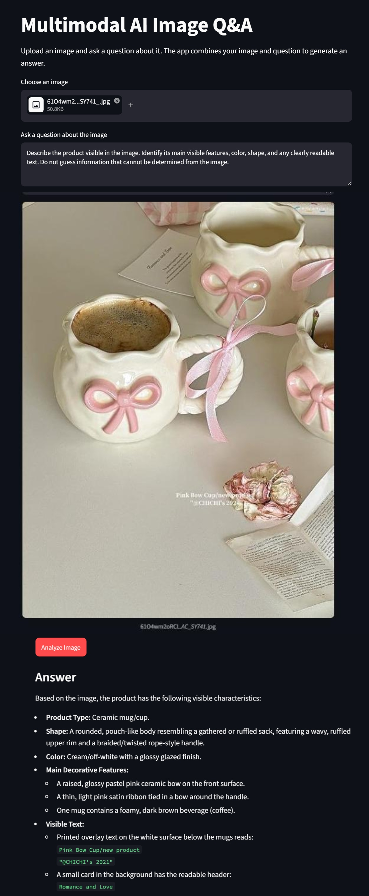
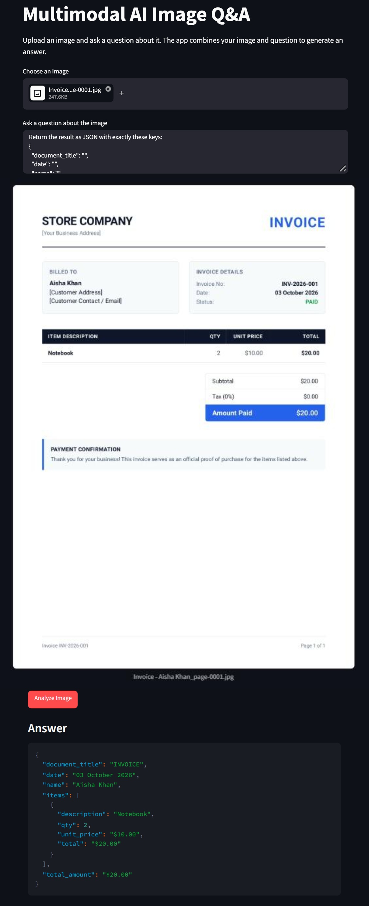
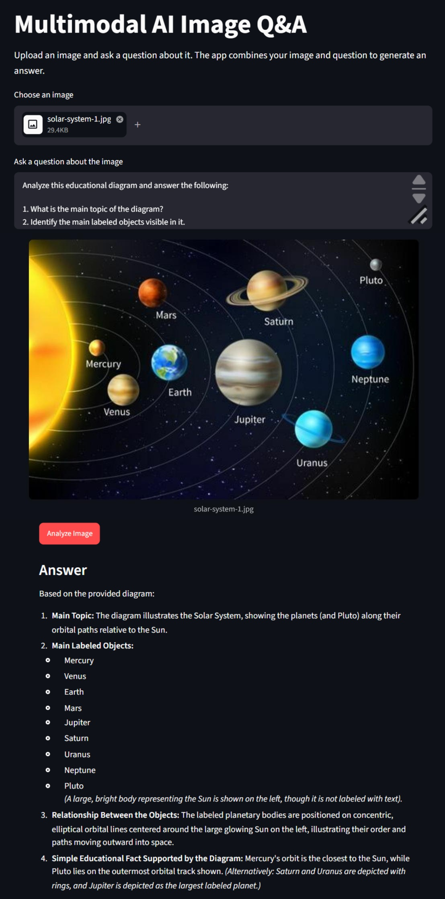
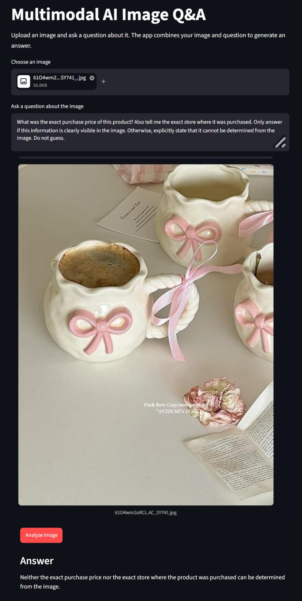

# Multimodal AI Image Q&A

A simple multimodal Generative AI application that allows users to upload an image and ask questions about its visual content.

The application combines an image with a natural-language question and sends both to a Gemini multimodal model. The model analyzes the visual information and generates a response based on the contents of the image.

This project was created as a practical experiment to understand how multimodal Generative AI can process visual and textual information together.

---

## Project Overview

Traditional text-only AI applications work primarily with written prompts.

Multimodal AI extends this capability by allowing an AI model to process multiple types of information, such as:

- Text
- Images
- Audio
- Video

This project focuses specifically on **image + text** interaction.

The user uploads an image and asks a question about it. The application sends both inputs to a multimodal Gemini model and displays the generated response.

---

## Objectives

The main objectives of this experiment were to:

1. Understand what multimodal Generative AI means.
2. Explore image understanding.
3. Test visual question answering.
4. Extract information from documents and images.
5. Return extracted information in a structured format.
6. Compare how the model responds to different types of prompts.
7. Test how the model handles information that is not visible in an image.
8. Build a simple practical application using a multimodal AI API.
9. Explore a real-world use case for multimodal AI.

---

## Features

- Upload an image through a web interface.
- Supports PNG, JPG, and JPEG images.
- Enter a natural-language question about the image.
- Send image + text together to a multimodal AI model.
- Generate descriptions of visible objects and features.
- Answer questions about visual content.
- Extract visible text and document information.
- Return structured JSON when requested.
- Handle cases where requested information is not visible.
- Display generated responses directly in the application.
- Handle API errors gracefully.
- Keep the API key in an environment variable.

---

## Technology Stack

- **Python**
- **Streamlit**
- **Google Gemini API**
- **Google GenAI Python SDK**
- **python-dotenv**

---

## Application Architecture

The application follows a simple request flow:

```text
                User
                  |
                  |
          Upload Image
                  |
                  +
          Enter Question
                  |
                  v
        Streamlit Application
                  |
                  |
       Image + Text Instruction
                  |
                  v
       Gemini Multimodal Model
                  |
                  |
          Visual Analysis
                  |
                  v
         Generated Response
                  |
                  v
        Streamlit User Interface
```

The application does not use a database, authentication system, RAG pipeline, or AI agent. The goal is to keep the implementation simple and focus on understanding multimodal AI.

---

## How Multimodal Processing Works

The application receives two inputs:

### 1. Visual Input

The user uploads an image.

The image may contain:

- Objects
- Products
- Documents
- Diagrams
- Visible text
- Labels
- Other visual information

### 2. Text Input

The user enters a question or instruction.

For example:

```text
Describe the product visible in the image.
```

The application sends the image and text instruction to the multimodal model.

The model then analyzes the visual information in the context of the user's question and generates a response.

---

## Project Workflow

```text
1. User uploads an image
           ↓
2. User enters a question
           ↓
3. Application validates the inputs
           ↓
4. Image + question are sent to Gemini
           ↓
5. Gemini analyzes the visual information
           ↓
6. Gemini generates a response
           ↓
7. Response is displayed to the user
```

---

# Experiments and Tests

The application was tested using multiple image types to explore different multimodal capabilities.

---

## Test 1 — Product Image Understanding

### Image Type

Product image containing ceramic mugs/cups.

### Prompt

```text
Describe the product visible in the image. Identify its main visible features, color, shape, and any clearly readable text. Do not guess information that cannot be determined from the image.
```

### Result

The model identified the product as a ceramic mug/cup and described visible characteristics including:

- Product type
- Shape
- Cream/off-white color
- Glossy finish
- Pink ceramic bow
- Ribbon decoration
- Visible coffee
- Readable text in the image

The model was also able to identify visible text such as:

```text
Pink Bow Cup/new product
"@CHICHI's 2021"
```

### Capability Demonstrated

This test demonstrated:

- Image understanding
- Object recognition
- Visual feature extraction
- Color recognition
- Visible text recognition

### Screenshot



---

## Test 2 — Document Understanding and Structured Extraction

### Image Type

Fictional invoice/document.

### Prompt

```text
Extract the important information visible in this document.

Return the result as JSON with exactly these keys:
{
  "document_title": "",
  "date": "",
  "name": "",
  "items": [],
  "total_amount": ""
}

Use only information that is clearly visible in the image. If a field is not visible, return an empty string or empty array. Do not guess.
```

### Result

The model returned structured information:

```json
{
  "document_title": "INVOICE",
  "date": "03 October 2026",
  "name": "Aisha Khan",
  "items": [
    {
      "description": "Notebook",
      "qty": 2,
      "unit_price": "$10.00",
      "total": "$20.00"
    }
  ],
  "total_amount": "$20.00"
}
```

### Capability Demonstrated

This test demonstrated:

- Document understanding
- Text extraction
- OCR-like visual text recognition
- Field extraction
- Structured output
- JSON generation

### Screenshot



---

## Test 3 — Educational Diagram Understanding

### Image Type

Solar System educational diagram.

### Prompt

```text
Analyze this educational diagram and answer the following:

1. What is the main topic of the diagram?
2. Identify the main labeled objects visible in it.
3. Explain the relationship between the objects shown.
4. Give one simple educational fact that can be directly supported by the diagram.

Use only information visible in the image. If something cannot be determined from the diagram, clearly say so. Do not guess.
```

### Result

The model identified the diagram as representing the Solar System and identified visible labeled objects including:

- Mercury
- Venus
- Earth
- Mars
- Jupiter
- Saturn
- Uranus
- Neptune
- Pluto

It also explained the relationship between the planets and their orbital paths around the Sun.

### Capability Demonstrated

This test demonstrated:

- Visual question answering
- Diagram understanding
- Label recognition
- Relationship understanding
- Educational image analysis

### Screenshot



---

# Test 4 — Information Not Visible in the Image

An important part of the experiment was testing whether the model would avoid inventing information that could not actually be determined from the image.

### Prompt

```text
What was the exact purchase price of this product? Also tell me the exact store where it was purchased. Only answer if this information is clearly visible in the image. Otherwise, explicitly state that it cannot be determined from the image. Do not guess.
```

### Result

The model responded:

```text
Neither the exact purchase price nor the exact store where the product was purchased can be determined from the image.
```

### Capability Demonstrated

This test demonstrated that the model can recognize when requested information is not available from the provided visual input.

This is important because a multimodal AI system should distinguish between:

- Information that is visible.
- Information that can reasonably be inferred from the image.
- Information that cannot be determined from the image.

### Screenshot



---

# Summary of Experiments

| Test | Image Type | Capability Tested | Result |
|---|---|---|---|
| 1 | Product image | Image understanding and visible text recognition | Successful |
| 2 | Invoice/document | Information extraction and structured JSON | Successful |
| 3 | Educational diagram | Visual question answering and diagram understanding | Successful |
| 4 | Product image | Handling unavailable information | Successful |

---

# Prompt Quality Experiment

The project also explores an important aspect of multimodal AI: **prompt quality**.

A vague prompt provides less guidance to the model.

For example:

```text
What is this?
```

A more specific prompt provides clear instructions:

```text
Describe the product visible in the image. Identify its main visible features, color, shape, and any clearly readable text. Do not guess information that cannot be determined from the image.
```

The second prompt provides:

- A specific task
- Specific information to extract
- A constraint against guessing

This makes the expected response clearer and demonstrates why prompt design matters when working with multimodal models.

---

# Real-World Use Case

## AI Document Assistant

One practical use case for this technology is an **AI Document Assistant**.

A user could upload documents such as:

- Invoices
- Receipts
- Forms
- Product sheets
- Timetables
- Other business documents

The user could then ask questions about the document or request specific information.

For example:

```text
Extract the invoice number, date, customer name, items, quantities, and total amount.
```

The system could return the extracted information in a structured format.

### Example Workflow

```text
User uploads invoice
        ↓
AI analyzes document image
        ↓
Text and fields are extracted
        ↓
Information is returned as structured data
        ↓
Application can use the structured data
```

This could help reduce manual data entry and make document information easier to process.

In a production system, extracted information should still be validated before being used for financial, legal, or other important decisions.

---

# Other Possible Applications

Multimodal AI can also be used in:

### Education

Students could upload an educational diagram and ask questions about it.

```text
Explain this diagram in simple terms.
```

### Product Analysis

Users could upload a product image and ask about visible characteristics.

```text
Describe the visible features of this product.
```

### Accessibility

An AI system could describe visual content for users who have difficulty accessing images.

### Customer Support

A customer could upload an image of a product or problem and ask for assistance.

### Receipt Processing

Users could upload receipts and extract:

- Date
- Items
- Prices
- Total amount

### Visual Search

An application could analyze an uploaded image and identify visually relevant information.

---

# Limitations

Although multimodal AI can understand images, it has important limitations.

### 1. Image Quality

Low-resolution, blurry, dark, or partially obstructed images may reduce the accuracy of the response.

### 2. Small Text

Very small or unclear text may be difficult for the model to read correctly.

### 3. Missing Information

The model cannot reliably determine information that is not visible in the image.

The fourth experiment demonstrated this limitation.

### 4. Incorrect Interpretation

The model may sometimes misunderstand an object, diagram, relationship, or visual detail.

### 5. Hallucination Risk

A model can potentially generate information that is not supported by the input.

For this project, prompts explicitly instructed the model not to guess when information was unavailable.

### 6. API Availability

The availability of specific Gemini models can change over time. During development, the original model configuration returned a model availability error and the application was updated to use the currently available model specified by the Gemini API response.

### 7. Production Validation

For important applications such as financial document processing, AI-generated results should be validated before being treated as authoritative data.

---

# Security

The Gemini API key is stored in an environment variable.

Example:

```env
GEMINI_API_KEY=your_api_key_here
```

The `.env` file is excluded from Git using `.gitignore`.

The API key should never be:

- Hard-coded into source code
- Added to screenshots
- Added to README files
- Committed to GitHub
- Shared publicly

---

# Project Structure

```text
multimodal-ai-image-qa/
│
├── app.py
├── README.md
├── requirements.txt
├── .env
├── .gitignore
│
└── screenshots/
    ├── test-1-product.png
    ├── test-2-document.png
    ├── test-3-educational.png
    └── test-4-not-visible.png
```

The `.env` file and virtual environment should not be committed to GitHub.

---

# Installation

## 1. Clone the repository

```bash
git clone YOUR_GITHUB_REPOSITORY_URL
cd multimodal-ai-image-qa
```

## 2. Create a virtual environment

Windows:

```powershell
python -m venv .venv
```

Activate it:

```powershell
.venv\Scripts\Activate.ps1
```

## 3. Install dependencies

```powershell
pip install -r requirements.txt
```

## 4. Configure the API key

Create a `.env` file in the project root:

```env
GEMINI_API_KEY=your_api_key_here
```

Replace the placeholder with your own Gemini API key.

## 5. Run the application

```powershell
streamlit run app.py
```

The application will open in the browser.

---

# Requirements

The main Python dependencies used by this project are:

```text
streamlit
google-genai
python-dotenv
```

The complete dependency list is provided in `requirements.txt`.

---

# Learning Outcomes

By completing this project, the following multimodal AI concepts were explored:

- Difference between text-only and multimodal AI
- Image understanding
- Visual question answering
- Image-based text extraction
- Document understanding
- Structured information extraction
- Prompt engineering for visual tasks
- Combining image and text inputs
- Handling unavailable visual information
- Practical integration of a multimodal AI API
- Real-world applications of multimodal Generative AI

---

# Conclusion

This project demonstrated how Generative AI can work with more than just text.

By combining an uploaded image with a written question, the application was able to perform tasks such as:

- Understanding product images
- Reading visible text
- Extracting information from documents
- Returning structured JSON
- Understanding educational diagrams
- Answering questions about visual relationships
- Recognizing when requested information was not visible

The experiment shows how multimodal AI can be integrated into practical software applications and provides a foundation for more advanced systems involving document processing, accessibility, education, customer support, product analysis, RAG, and AI agents.

---

## Author

**Ajiya Shaukat**

Software Engineering Student & Full-Stack Developer

GitHub: `https://github.com/syeda-ajiya56`
